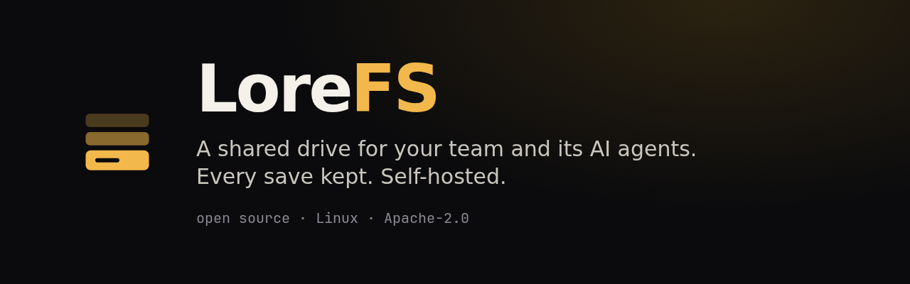
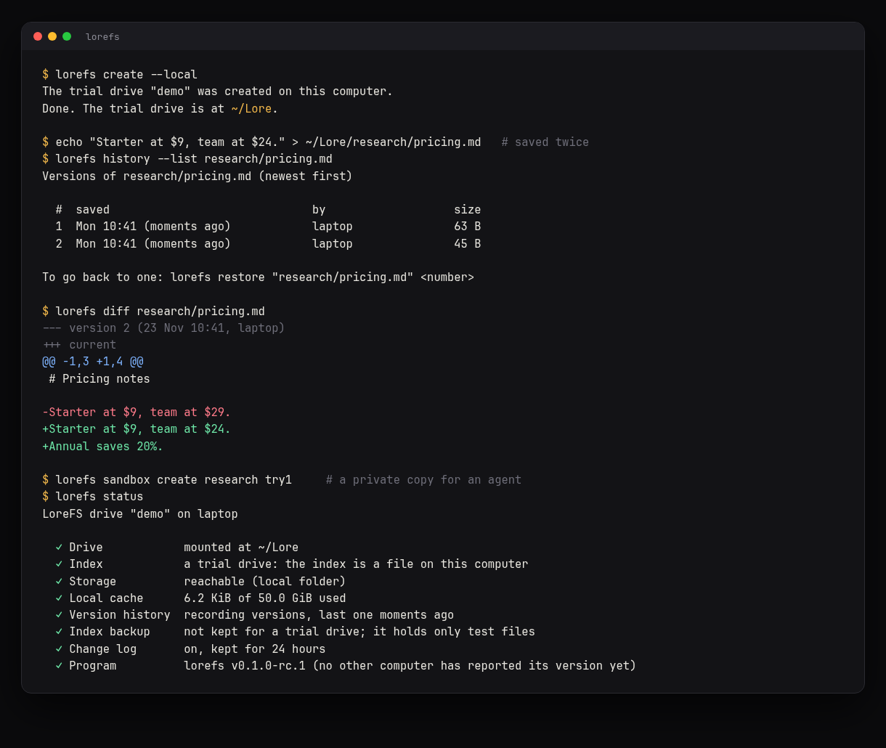

<div align="center">



**A free, open-source shared drive for small teams and their AI agents. Everyone sees the same files within seconds, every save is kept, and agents work in private copies before anything changes for the team.**

Self-hosted on a storage bucket and a small index server you control. No per-seat pricing, no vendor holding your files.

[](LICENSE)
[](https://github.com/T3-Venture-Labs-Limited/LoreFS/actions/workflows/test.yml)
[](https://github.com/T3-Venture-Labs-Limited/LoreFS/releases)
[](#known-limits)
[](https://juicefs.com)

[Try it](#try-it-in-two-minutes) · [Share a drive](#share-a-drive-with-a-colleague) · [For AI agents](#for-ai-agents) · [How it works](#how-it-works) · [Compared](#lorefs-compared) · [FAQ](#faq)



</div>

## What is LoreFS?

LoreFS turns a storage bucket and a small database into a folder that looks the same on every computer: `~/Lore`. Put notes, research, plans, assets and agent handoffs in it. A file saved on one computer shows up on the others within seconds.

Three things make it different from a synced folder:

- **Every save is kept.** Each change to a file is recorded with who made it and when. `lorefs history` lists the versions, `lorefs diff` shows what changed, and `lorefs restore` brings one back. Deleted files can be recovered too.
- **Agents get a sandbox.** `lorefs sandbox create` makes a private copy of a folder that costs no extra storage. An agent can edit freely there, you review the diff, and only then does the result go back to the shared folder.
- **You own it.** The files live in your own S3-compatible bucket and the index on a server you run. LoreFS is a command line program and two background services; there is nothing to sign up for.

It is built for teams of two to a few dozen people who work with AI coding and writing agents and want one place where humans and agents share knowledge without stepping on each other.

## Features

- **Near-instant sharing.** Changes appear on other computers in a few seconds. Folders are fast to open, small files are kept ready locally, and `lorefs pin` keeps a whole folder ready for offline use.
- **Version history for every file.** Recorded from the drive's own change log, so it works for any program that saves: editors, scripts, agents. Saves less than half a second apart are grouped, and large copies get one version per file. Restoring never destroys anything; the content it replaces is kept as a version too.
- **Deleted files come back.** Deleted and replaced files are kept for 7 days in the trash; versions are kept for 30 days.
- **Safe workspaces for agents.** Sandboxes, a rules file that explains the conventions to every agent (`AGENTS.md` at the top of the drive), exclusive-create for claiming work, and JSON output on every command.
- **Honest status.** `lorefs status` explains in plain words whether the drive works, what is wrong and what to do, and exits with a code scripts can use.
- **Your storage, your index.** Any S3-compatible bucket (Backblaze B2, Cloudflare R2, DigitalOcean Spaces, AWS S3, MinIO, ...) and any Redis-compatible index (Redis, Valkey). `lorefs server init` writes a ready-to-run encrypted Valkey setup.
- **Backup and restore that was rehearsed.** `lorefs backup` keeps a second copy at another provider; `lorefs restore-index --drill` proves a restore works without touching anything real.
- **Secure by default.** The index connection is encrypted and its certificate checked; secrets are never taken from command-line arguments or printed; settings are readable only by you.
- **Trial drives.** `lorefs create --local` makes a drive on one computer with no account, network or password, so you can try everything first.

## Try it in two minutes

You need Linux with FUSE 3 (`fuse3`). Nothing else, and no account anywhere.

```bash
curl -fsSL https://github.com/T3-Venture-Labs-Limited/LoreFS/releases/latest/download/install.sh | sh
lorefs create --local
```

A folder called `Lore` appears in your home folder. Save a file in it, save it again, and look:

```bash
lorefs history ~/Lore/notes.md
lorefs status
```

Prefer to build it yourself? You need Go (see `go.mod`):

```bash
git clone https://github.com/T3-Venture-Labs-Limited/LoreFS
cd LoreFS && make build && ./install.sh
```

A trial drive lives on one computer. To share:

## Share a drive with a colleague

A shared drive needs two things you provide:

- **Storage** for the files: an S3-compatible bucket and an access key that can write to it.
- **An index**, the small database that remembers file names and folders: a Redis-compatible server that accepts encrypted connections. If you do not have one, `lorefs server init` writes a folder that runs one with Docker.

```bash
lorefs create --bucket https://my-bucket.s3.us-west-004.backblazeb2.com \
              --access-key <key> --index rediss://index.example.net:6379/1
```

Secrets are asked for at a hidden prompt. It prints a **join code**. Send it to your colleague through a private channel (it works like a password), and they run:

```bash
curl -fsSL https://github.com/T3-Venture-Labs-Limited/LoreFS/releases/latest/download/install.sh | sh
lorefs join
```

See [docs/creating-a-drive.md](docs/creating-a-drive.md) for what to ask your storage provider for, and [docs/running-an-index.md](docs/running-an-index.md) for running the index yourself.

## For AI agents

The drive carries a rules file, `~/Lore/AGENTS.md`, that tells any agent how to behave in it: where things go, how to keep folders shallow, how to use history, the trash and sandboxes, and what never to do. Every command has `--json`, and [`skills/lorefs/SKILL.md`](skills/lorefs/SKILL.md) is a ready-made skill file for agents such as Claude Code, Codex and Cursor.

```bash
# An agent doing a risky bulk edit:
lorefs sandbox create website/research competitors-pass --json   # a private copy, no extra storage
#   ... edit freely inside the sandbox ...
lorefs sandbox diff competitors-pass                              # review exactly what changed
lorefs sandbox apply competitors-pass --yes                       # bring it back; replaced files keep their history

# Something went wrong afterwards:
lorefs history website/research/pricing.md --json
lorefs restore website/research/pricing.md 2
```

Two agents (or people) saving the same file do not merge: the later save wins and the earlier one stays in the history. For claiming a job, create a claim file with exclusive create; exactly one creator succeeds on any computer.

## How it works

| Part | What it is |
|---|---|
| **Storage bucket** | Holds the file contents. Yours, at any S3-compatible provider. |
| **Index** | A small Redis-compatible server that remembers names, folders and which blocks make up each file. Near your team, encrypted, password-protected. |
| **Mount** | On each computer, [JuiceFS](https://juicefs.com) mounts the drive at `~/Lore`, with a local cache so reads are fast. |
| **Helper** | A background service that follows the drive's change log to record versions, keeps small files ready, tidies old versions and tells you when the drive stops or comes back. |
| **`lorefs`** | One command for everything above: create, join, status, history, sandboxes, backup, restore, update. |

LoreFS adds sharing conventions, history, agent workspaces, status, backup and a safe setup on top of JuiceFS. JuiceFS does the heavy lifting of turning a bucket and an index into a fast POSIX filesystem, and LoreFS runs it as a separate program rather than copying it.

## LoreFS compared

| | LoreFS | Dropbox, Google Drive and similar | Hosted drives for agents |
|---|---|---|---|
| Who holds the files | You: your bucket, your index | The vendor | The vendor |
| Price | Free and open source (Apache-2.0); you pay your storage and a small server | Per seat | Per seat or per usage |
| Version history | Every save, for any program, 30 days | Yes, with limits by plan | Varies |
| Agent sandboxes | Built in, free copy-on-write | No | Varies |
| Works with plain files and any tool | Yes, it is a normal folder | Yes, through a sync client | Often through an API or plugin |
| Setup | You bring a bucket and an index | None | None |
| Platforms | Linux only for now | Everywhere | Varies |

Hosted tools are more polished and need no setup. LoreFS is for teams who want to keep their files, avoid per-seat pricing, and give agents a safe place to work.

## Everyday commands

| | |
|---|---|
| `lorefs status` | Is the drive working, and what to do if not |
| `lorefs history <file>` | Earlier versions of a file; restore one |
| `lorefs diff <file>`, `lorefs restore <file> <n>` | What changed; make a version current |
| `lorefs log` | Recent saves, deletions and restores on every computer |
| `lorefs trash` | Files deleted or replaced in the last 7 days |
| `lorefs sandbox create <folder>` | A private copy for an agent; `sandbox diff` and `sandbox apply` bring changes back |
| `lorefs pin <folder>` | Keep a folder ready on this computer |
| `lorefs invite` | A join code for another computer |
| `lorefs backup setup` / `run` / `schedule` | A second copy at another provider |
| `lorefs update` | The newest release |

## FAQ

**Is LoreFS free?**
Yes. It is free and open source under the Apache License 2.0. You pay your storage provider for the bytes and for a small server for the index (a few dollars a month is typical).

**What do I need to run it?**
Linux with FUSE 3, an S3-compatible bucket and a Redis-compatible index. A small virtual server is enough for the index.

**Is it a Dropbox or Google Drive alternative?**
For a small team that works in a shared folder and wants version history, agent sandboxes and ownership of its data, yes. It does not have a web interface, sharing links or comments.

**Can several people edit the same file?**
Not at the same moment: there is no merging. The later save wins and the earlier one stays in the history. For shared documents, give each writer their own file.

**Does it work offline?**
Files you have opened or pinned stay readable. Saving needs the connection.

**Does it work with my agent?**
Any agent that can read and write files and run commands. [`AGENTS.md`](AGENTS.md) and [`skills/lorefs/SKILL.md`](skills/lorefs/SKILL.md) are written for agents.

**How is it different from JuiceFS?**
JuiceFS is the filesystem engine underneath. LoreFS is the product around it: one-command setup, version history, sandboxes, status, backup and restore, updates.

**Is my data encrypted?**
Connections to the index are encrypted and its certificate is checked. File contents are as private as your storage bucket; LoreFS does not add its own encryption of file contents.

## Privacy and security

- Your files go from your computers to your bucket. No LoreFS service sees them, and there is no telemetry.
- A join code lets anyone who holds it read, change and delete every file on the drive. Treat it like a password.
- Report security problems privately: see [SECURITY.md](SECURITY.md).

## Known limits

- Linux only for now. macOS and Windows are not supported yet.
- Two people saving the same file at once do not merge.
- Video files are not versioned (they are large and usually replaced, not edited); a deleted or replaced video is kept for 7 days in the trash.
- Every computer acts as the user who created the drive, so file ownership inside the drive is not separate per person.
- Version history is only as complete as the drive's change log; see [docs/version-history.md](docs/version-history.md).

## Documentation

[Creating a drive](docs/creating-a-drive.md) · [Running your own index](docs/running-an-index.md) · [Backup and restore](docs/backup-and-restore.md) · [How version history works](docs/version-history.md) · [Setting up an agent](docs/agents.md) · [Performance notes](docs/performance.md) · [Changelog](CHANGELOG.md)

## Development

```bash
make build         # bin/lorefs
make test          # vet and unit tests
make check         # unit tests and the privacy check
scripts/itest.sh --fast        # two computers on one drive (needs Docker and FUSE)
```

See [CONTRIBUTING.md](CONTRIBUTING.md) for the other test scripts and how to send a change.

## License

Apache License 2.0. See [LICENSE](LICENSE) and [NOTICE](NOTICE).
